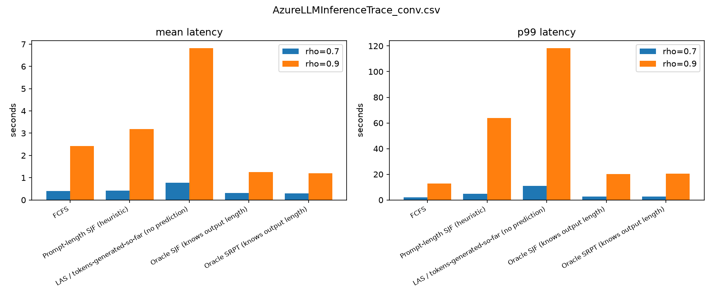
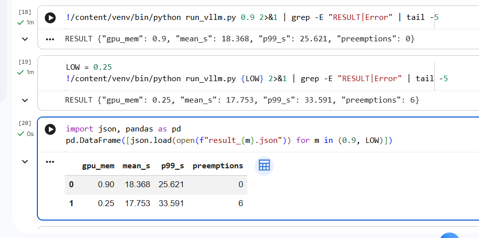

# LLM serving replay

Does knowing a request's prompt length help schedule LLM inference requests, compared with knowing its output length?

## Finding

At 90% load:

- An oracle that knows output length roughly halves mean latency vs FCFS.
- Ordering by prompt length gets none of that gain, it's actually worse than FCFS.
- Even the oracle has a worse p99 than FCFS, so a better mean isn't free.
- Prompt length and output length are basically uncorrelated (Spearman 0.07).

Why prompt-length ordering loses to FCFS instead of just doing nothing: mid-length prompts have the longest outputs in this trace (third quartile averages ~408 output tokens vs ~114-195 for the rest), so sorting by prompt length pushes the longest jobs to the front instead of the back. Random order gives roughly the same mean as FCFS, as expected.

## Figure



## Run it

Download the trace CSV from the Azure Public Dataset:

https://github.com/Azure/AzurePublicDataset/blob/master/data/AzureLLMInferenceTrace_conv.csv

Install dependencies, then run:

```
pip install -r requirements.txt
python llm_sched_sim.py AzureLLMInferenceTrace_conv.csv 0.7 0.9 --plot
```

For the vLLM check, open vllm_check.ipynb in Colab with a T4 GPU.

## Results

```
AzureLLMInferenceTrace_conv.csv  rho=0.7  n=19366
policy                                                mean       p99  gain captured
FCFS                                                  0.40      2.12           0.0%
Prompt-length SJF (heuristic)                         0.43      4.73         -19.8%
LAS / tokens-generated-so-far (no prediction)         0.77     10.83        -311.4%
Oracle SJF (knows output length)                      0.31      2.52          79.4%
Oracle SRPT (knows output length)                     0.29      2.58         100.0%

AzureLLMInferenceTrace_conv.csv  rho=0.9  n=19366
policy                                                mean       p99  gain captured
FCFS                                                  2.42     12.95           0.0%
Prompt-length SJF (heuristic)                         3.19     63.73         -63.7%
LAS / tokens-generated-so-far (no prediction)         6.83    118.36        -362.3%
Oracle SJF (knows output length)                      1.25     20.29          96.0%
Oracle SRPT (knows output length)                     1.20     20.49         100.0%
```

## Sensitivity

Oracle SRPT mean-latency reduction versus FCFS at 90% load, for different prefill costs:

| prefill cost | reduction |
|---|---|
| 0     | 55.7% |
| 0.005 | 53.9% |
| 0.02  | 50.4% |
| 0.05  | 49.8% |

The gain stays in a similar range regardless of how prefill is priced.

## Limitations

Single server, no batching. Preemption is free, with no cost for keeping or recomputing KV cache. Service time is decode tokens plus a prefill cost times prompt tokens.

## Next

I'd extend this to batched serving with KV-cache preemption costs, using a vLLM-based simulator instead of this single-server model. I'd also want to test how much of the oracle gain a learned length predictor recovers against these baselines, given the same signals.

## vLLM check

The replay assumes free preemption. To see what that leaves out, I sent a burst of the first 200 trace requests (real prompt and output lengths, submitted at once) through vLLM 0.6.3 on a Colab T4 GPU with Qwen2.5-0.5B-Instruct, at two KV-cache memory levels.

| gpu_memory_utilization | mean (s) | p99 (s) | preemptions |
|---|---|---|---|
| 0.90 | 18.37 | 25.62 | 0 |
| 0.25 | 17.75 | 33.59 | 6 |



With less KV-cache memory, mean latency barely changed but p99 latency rose 31%: preemption cost falls on a few requests, which is the tail effect the replay misses.

Limitations: one small model, one GPU, 200 requests submitted as a burst (not replayed at trace arrival times), single run.

## Data source

Trace data from the Azure Public Dataset (github.com/Azure/AzurePublicDataset).
